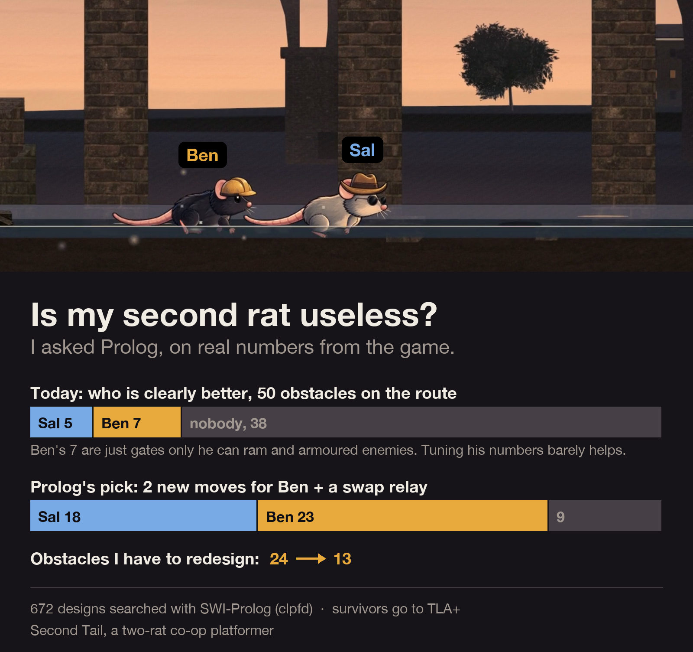
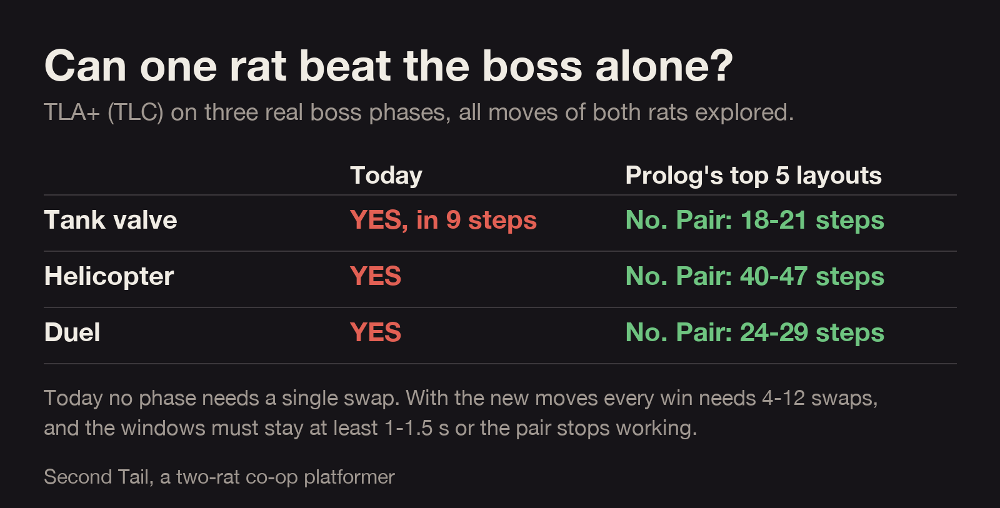

# propose-and-check

An agent skill for designing rules before you write them: **Prolog proposes, TLA+ checks.**

Model checking tells you whether a design behaves. It cannot tell you whether the design is the one you want, because the spec comes from what people want, not from math. This skill adds the step in front of it:

1. You write your design rules as plain sentences.
2. **Prolog (clpfd)** enumerates every design that satisfies them, counts what each rule removes, and ranks the survivors by the cost you care about.
3. **TLA+ (TLC)** checks how the top designs behave over time and finds the shortest path to anything you said must never happen.
4. Every counterexample becomes a test on the real code, and often a rule you forgot to write.

The skill works with Claude Code, Cursor (it builds on [pstack](https://github.com/cursor/plugins/tree/main/pstack) by Lauren Tan) and any agent that reads `SKILL.md`. Proposed upstream as [cursor/plugins#1192](https://github.com/cursor/plugins/pull/1192).

## When it helps

- A few discrete choices (who owns which ability, which rule applies in which phase, an order, a tier), several rules that interact, and behavior over time.
- Game design: ability splits between characters, boss phases, unlock order, economy rules.
- Anywhere else with the same shape: permissions and roles, feature flags, pricing tiers, workflow states.

Skip it for feel, geometry, visuals and timing polish, and for small input spaces you can just enumerate on the real code.

## Real case: Second Tail

[Second Tail](https://para1992.itch.io/second-tail) is my co-op platformer about two rats, Sal and Ben. One player, swap with Q. I had a gut feeling Ben was dead weight and that the bosses did not really need both rats. I ran the loop on real numbers from the game code: 18 measured jump transitions (an exact port of the game's own reach check), 7 rat-specific gates, 19 boss phases.



**Prolog** searched 672 combinations (112 ability sets, 6 retunings of Ben's numbers):

- Today Sal is clearly better on 5 of 50 obstacles and Ben on 7, and Ben's 7 are only gates he must ram and armoured enemies. The feeling was right.
- Retuning Ben's jump and dash barely changes anything: Sal's double jump is never worse than Ben's dash on any measured jump.
- Two new moves for Ben plus a swap relay give Sal 18 and Ben 23, and cut the obstacles I have to redesign from 24 to 13.



**TLA+** on three real boss phases (tank valve, helicopter, duel):

- Today one rat wins every phase without a single swap. The tank goes down in 9 steps.
- With Prolog's top 5 layouts no solo win exists on any phase, and the pair still wins (18 to 47 steps, 4 to 12 swaps).
- Control runs fail as they should: give the opener and the finisher to the same rat and TLC finds a solo win again.
- The sweeps give the limits: the pair only works with vulnerable windows of at least 1.0 s (duel) and 1.5 s (tank), and the helicopter needs at least 3 hearts.

Full numbers and caveats: [case/RESULTS.md](case/RESULTS.md). Some inputs are designer assumptions (enemy counts, scores of non-jump obstacles), and the report says which.

## Try the toy example

```sh
# SWI-Prolog: brew install swi-prolog / apt install swi-prolog / winget install SWI-Prolog.SWI-Prolog
# TLC: any tla2tools.jar plus Java 11+
export TLA_HOME=/path/to/folder/with/tla2tools.jar
cd example && ./run-all.sh
```

Two heroes split eight abilities. 256 layouts, four rules and symmetry breaking leave 23, TLC strands a hero in 17 of them, and the rule learned from that counterexample makes Prolog propose exactly the 6 that passed. The recorded output is in [example/run.md](example/run.md).

## Install

Copy this folder into your agent's skills directory, for example `~/.claude/skills/propose-and-check/` for Claude Code, then ask for `/propose-and-check`.

## License

MIT
